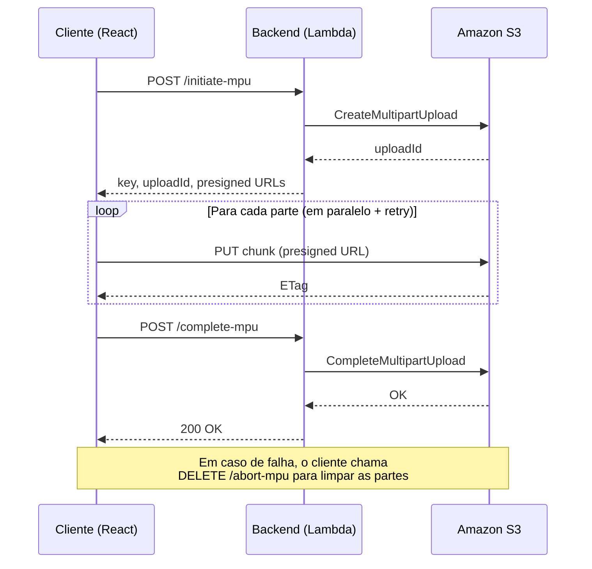

# S3 Multipart Upload


Aplicação de demonstração para upload de arquivos grandes no AWS S3 usando **multipart upload** com **URLs pré-assinadas** (presigned URLs). O frontend (React + Vite) fatia o arquivo em partes e envia cada uma diretamente para o S3, enquanto o backend (AWS Lambda via Serverless Framework) orquestra o ciclo de vida do upload.

## Como funciona

| Etapa          | O que acontece                                                                                                   |
| -------------- | --------------------------------------------------------------------------------------------------------------- |
| **Iniciar**    | O cliente fatia o arquivo em chunks de 5 MB e pede ao backend para iniciar o upload. O S3 devolve uma URL pré-assinada por parte. |
| **Enviar**     | Cada chunk é enviado direto ao S3 (`PUT`) via URL pré-assinada, em paralelo e com retry automático. Cada parte retorna um `ETag`. |
| **Concluir**   | Com todos os `ETag`s coletados, o cliente pede ao backend para concluir, juntando as partes no objeto final.     |
| **Abortar**    | Se uma parte falhar após as tentativas, o upload é abortado para não deixar partes órfãs. Uploads incompletos esquecidos são abortados após 1 dia por uma regra de lifecycle. |



## Stack

| Camada       | Tecnologias                                                                              |
| ------------ | --------------------------------------------------------------------------------------- |
| **Frontend** | React 19, Vite, TypeScript, Tailwind CSS, shadcn/ui, Base UI, Axios, Zod                 |
| **Backend**  | AWS Lambda (Node.js 24, arm64), Serverless Framework, AWS SDK v3, Zod                    |
| **Tooling**  | pnpm workspaces, Biome, Husky, lint-staged, commitlint (gitmoji)                         |

## Setup

### Pré-requisitos

- Node.js 24+
- pnpm 11+
- Conta AWS com credenciais configuradas (`aws configure`)

### 1. Instalar dependências

Na raiz do projeto (monorepo pnpm):

```bash
pnpm install
```

### 2. Deploy do backend

```bash
cd lambdas
pnpm serverless deploy
```

Ao final, o Serverless Framework exibe a **URL base da API** — guarde-a para o próximo passo.

### 3. Configurar e rodar o frontend

Crie o arquivo `front/.env` com a URL da API:

```env
VITE_API_URL=https://sua-api.execute-api.regiao.amazonaws.com
```

Inicie o servidor de desenvolvimento:

```bash
cd front
pnpm dev
```
